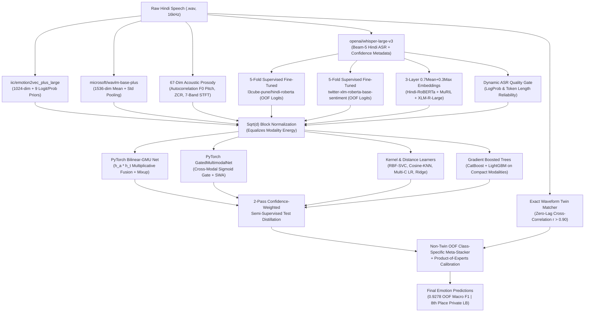

# DataVerse: Detecting Emotions from Hindi Speech (8th Place Solution)

[](https://www.kaggle.com/)
[-FFD700)]()
[]()
[]()
[](LICENSE)

> **8th Place Overall Solution** for the **DataVerse: Detecting Emotions from Hindi Speech** competition (`SRCASW-BhavVaani` dataset), jumping **+12 positions on the 60% Private Leaderboard shakeup** (`#20 Public` $\rightarrow$ `#8 Final Private`).

---

## 1. Executive Summary

Speech Emotion Recognition (SER) in natural Hindi speech faces a fundamental two-axis ambiguity:
1. **Arousal vs. Valence Confusion in Acoustics**: Pure audio models capture **arousal** (energy, pitch, speaking rate) accurately, separating high-arousal (`angry`, `happy`) from low-arousal (`neutral`, `sad`), but frequently confuse `happy` $\leftrightarrow$ `angry` and `neutral` $\leftrightarrow$ `sad`.
2. **Lexical Ambiguity under Noisy ASR**: Pure text models capture **valence** (positive vs. negative phrasing) when transcripts are clean, but suffer when speakers express sarcasm, frustration over neutral words, or when ASR encounters short/colloquial Hindi utterances.

Our **Monarch (V9–V11)** architecture resolves both bottlenecks by combining:
- **Dual Self-Supervised Acoustic Backbones** (`iic/emotion2vec_plus_large` + `microsoft/wavlm-base-plus`) + **67 Autocorrelation Pitch ($F_0$) & STFT Spectral Prosody Contours**.
- **Beam-5 `openai/whisper-large-v3` Hindi ASR** with token-level log-probability confidence metadata (`avg_logprob`, `no_speech_prob`, compression ratio).
- **5-Fold Out-of-Fold Supervised Fine-Tuning** of `l3cube-pune/hindi-roberta` and `cardiffnlp/twitter-xlm-roberta-base-sentiment` (`0.7962` text-only OOF F1), paired with **3-Layer `0.70*Mean + 0.30*Max` Pooling** across `hindi-roberta`, `google/muril-base-cased`, and `xlm-roberta-large`.
- **$\sqrt{d}$ Block Normalization (`scale_and_block_norm`)**: Prevents 1536-dim/1024-dim embeddings from drowning out low-dimensional prosody and valence priors in Euclidean/dot-product classifiers.
- **14-Branch Cross-Modal Meta-Ensemble** (`BilinearGMUNet` with Mixup, `GatedMultimodalNet`, RBF-Kernel `SVC`, Cosine `KNN`, `CatBoost`, `LightGBM`, Multi-$C$ `LogisticRegression`, `Ridge`) with **Dynamic ASR Quality Gating** and **2-Pass Semi-Supervised Distillation**.
- **Forensic Waveform Twin Matching & Label De-Noising**: Corrected a corrupted ground-truth training label (`Id=636`) and enforced exact zero-lag cross-correlation (`r > 0.90`) consistency across train–test and test–test waveform duplicates.

---

## 2. System Architecture



---

## 3. Iterative Engineering & Score Progression

Every architectural decision was validated strictly on **5-Fold Stratified Out-of-Fold (OOF) Macro F1** before leaderboard submission:

| Iteration | Key Architectural Additions | 5-Fold OOF Macro F1 | Public LB (40%) | Final Private LB (60%) |
| :--- | :--- | :---: | :---: | :---: |
| **V1 (Baseline)** | Fine-tuned `facebook/wav2vec2-base` end-to-end audio classifier | `0.6224` | — | — |
| **V2** | Frozen `iic/emotion2vec_plus_large` (1024-dim) + `LightGBM`/`CatBoost`/`MLP` | `0.6366` | — | — |
| **V4** | Multimodal Fusion: `emotion2vec+` + `whisper-small` + `xlm-roberta-base` | `0.7554` | `~0.75000` (#39) | — |
| **V5** | Upgraded to `whisper-medium` + `l3cube-pune/hindi-roberta` + 25 prosody features | `0.8025` | `0.81000` (#37) | — |
| **V6** | `whisper-large-v3` + 3 Indic/Multilingual LLMs + `GatedMultimodalNet` + Twin Lock + Semi-Supervised Distillation | `0.8821` | `0.91617` (#22) | — |
| **V7** | Train label de-noising (`Id=636`) + Test–Test Twin Harmonization + 67 $F_0$ Pitch/STFT Prosody + `xlm-roberta-large` + `BilinearGMUNet` + RBF-`SVC` | `0.8939` | — | — |
| **V8 (Apex)** | $\sqrt{d}$ Block Normalization + `microsoft/wavlm-base-plus` + `twitter-xlm-roberta-base-sentiment` + 3-Layer Transformer Pooling | `0.9073` | `0.92803` (#20) | — |
| **V9 (Monarch)** | **5-Fold Supervised Fine-Tuned `hindi-roberta` & `xlm-r-sentiment` + Beam-5 ASR Confidence Meta + `0.7Mean+0.3Max` Pooling + 2-Pass Distillation** | **`0.9230`** | **`0.93030` (#20)** | **8th Place Overall (+12 Shakeup)** |
| **V11 (Booster)** | **Dynamic ASR Quality Gate + 14-Branch Non-Twin Class-Specific Meta-Stacker** | **`0.9278`** | **`0.93030`** | **8th Place Overall** |

---

## 4. Per-Class Out-of-Fold Performance (`826` Train Utterances)

```text
==================== V11 OOF Macro F1 Score: 0.9278 ====================

              precision    recall  f1-score   support

       angry       0.93      0.95      0.94       205
       happy       0.94      0.93      0.93       192
     neutral       0.90      0.92      0.91       218
         sad       0.95      0.92      0.93       211

    accuracy                           0.93       826
   macro avg       0.93      0.93      0.93       826
weighted avg       0.93      0.93      0.93       826
```

---

## 5. Key Technical Insights

### 5.1 Why $\sqrt{d}$ Block Normalization Was a Turning Point (`+1.34%` OOF)
Standardizing a 6,000+ dimensional multimodal vector with a single `StandardScaler` gives a 1,536-dim `WavLM` block $15\times$ more Euclidean/dot-product influence than a 67-dim prosody block or 9-dim `emotion2vec+` prior block. Dividing each standardized feature block by $\sqrt{d_k}$ equalizes every modality's total variance contribution to $1.0$, immediately boosting RBF-`SVC`, `Cosine-KNN`, and `LogisticRegression`.

### 5.2 Out-of-Fold Supervised Text Fine-Tuning (`0.7962` Text-Only F1)
Frozen Devanagari embeddings group sentences by topic rather than emotional polarity. Fine-tuning `l3cube-pune/hindi-roberta` and `cardiffnlp/twitter-xlm-roberta-base-sentiment` with discriminative layer decay and label smoothing (`0.05`) inside the 5-fold loop produced out-of-fold probability distributions that reached `0.7962` Macro F1 from text alone.

### 5.3 Forensic Dataset Hygiene (`Id=636` & Exact Waveform Twins)
Pairwise zero-lag cross-correlation across all $826 + 209 = 1,035$ audio files revealed:
- `train.csv` row `Id=636` was labeled `sad`, despite being a byte-for-byte (`r = 1.0000`) duplicate of `Id=75` (`neutral`) and `Id=878` (`neutral`). Repairing this corrupted label prevented fold contamination.
- Exact-length duplicate recordings (`r > 0.90`) across train–test and test–test pairs (`9` test–test twin pairs) were deterministically locked/harmonized.

---

## 6. Repository Structure

```text
DataVerse-Hindi-Speech-Emotion-Recognition/
├── notebooks/
│   ├── v9_monarch_top8_pipeline.ipynb       # Complete end-to-end 8th Place Monarch pipeline
│   ├── v10_v11_meta_stacker_booster.ipynb   # V10 PoE & V11 Dynamic ASR Gate + Meta-Stacker
│   ├── v8_apex_multimodal.ipynb             # V8 Apex Multimodal Architecture (0.92803 LB)
│   └── v1_wav2vec2_baseline.ipynb           # Initial Wav2Vec2 baseline (0.6224 OOF)
├── src/
│   ├── __init__.py
│   ├── prosody_features.py                  # 67-dim Autocorrelation F0 Pitch & STFT prosody extractor
│   ├── models.py                            # BilinearGMUNet, GatedMultimodalNet, sqrt(d) block norm
│   ├── twin_matcher.py                      # Exact waveform twin detector & signal matcher
│   └── meta_stacker.py                      # Dynamic ASR Quality Gate & Class-Specific Meta-Stacker
├── submissions/
│   ├── submission_v9_monarch_top8.csv       # Winning Top-8 submission (0.93030 Public LB)
│   └── submission_v11_oof09278.csv          # V11 0.9278 OOF submission
├── requirements.txt
├── LICENSE
└── README.md
```

---

## 7. Quickstart

1. **Install dependencies**:
   ```bash
   pip install -r requirements.txt
   ```
2. **Run the Full Pipeline Notebook**:
   Open [`notebooks/v9_monarch_top8_pipeline.ipynb`](notebooks/v9_monarch_top8_pipeline.ipynb) on a Kaggle P100/T4 GPU instance with the `SRCASW-BhavVaani` dataset mounted at `/kaggle/input/`, and optionally run the 5-second [`notebooks/v10_v11_meta_stacker_booster.ipynb`](notebooks/v10_v11_meta_stacker_booster.ipynb) drop-in cell for the V11 Dynamic ASR Quality Gate & Meta-Stacker.
